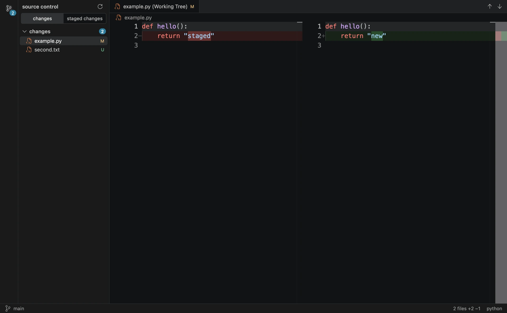

<p align="center">
  
</p>

<h1 align="center">senterm</h1>

<p align="center">a project-first macos terminal built on ghostty.</p>

<p align="center">
  <a href="#try-the-preview">try the preview</a> ·
  <a href="#build-from-source">build from source</a> ·
  <a href="docs/senterm-roadmap.md">roadmap</a>
</p>

keep your dev servers, coding agents, and shells in one window instead of
opening a separate window for every repo. senterm adds a folder-based sidebar
and a git changes viewer to ghostty's native macos terminal.

## what's inside

- **project sidebar** — group tabs by folder, add terminals to a project, and
  hide the sidebar when you want the full window for your terminal.
- **split panes** — run a server beside a shell or coding agent in the same tab.
- **git changes** — choose **file → git changes…** or click the git button in the
  sidebar. review staged and unstaged files with syntax highlighting, line
  totals, and a side-by-side diff in its own window.
- **theme picker** — choose **senterm → themes…** to preview and apply a bundled
  palette, including abyssal trench.

[](site/shots/git-changes.webp)

## try the preview

1. open the [macos build workflow](https://github.com/0Tarun0709/senterm/actions/workflows/senterm-dmg.yml)
   and select a successful run on the `senterm` branch.
2. while signed in to github, download the `senterm-macos-universal` artifact
   and unzip it. the disk image supports intel and apple silicon.
3. open `senterm-macos-universal.dmg` and drag senterm into applications.

preview builds are ad-hoc signed and not notarized. macos may show a warning
on first launch. only open a preview from a build you trust.

## build from source

use full xcode 26 with the metal toolchain, zig 0.17.0, nushell, and node.js
with npm. the standalone macos command line tools are not enough.

```sh
git clone --branch senterm https://github.com/0Tarun0709/senterm.git
cd senterm
export DEVELOPER_DIR=/Applications/Xcode.app/Contents/Developer

zig build -Doptimize=ReleaseFast -Demit-macos-app=false -Dxcframework-target=universal
nu macos/build.nu --configuration ReleaseLocal
open macos/build/ReleaseLocal/senterm.app
```

## credits and license

senterm is a fork of [ghostty](https://github.com/ghostty-org/ghostty). the
terminal engine, metal renderer, and native pane handling come from ghostty.
see the [upstream docs](https://ghostty.org/docs) for shared terminal settings
and keybindings. the previous swiftterm-based app lives in
[senterm-legacy](https://github.com/0Tarun0709/senterm-legacy).

licensed under the [mit license](LICENSE).
