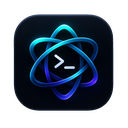

<p align="center">
  
</p>

# SenTerm

[](#getting-started)
[](https://github.com/0Tarun0709/senterm/actions/workflows/senterm-dmg.yml?query=branch%3Amain)

SenTerm is a project-first macOS terminal built on Ghostty. It groups terminal
tabs by project folder, so you can run a coding agent in one pane, watch your
dev server in another, and switch between repositories from the same sidebar.

When an agent finishes a change, open **Git changes** from the active terminal
to review that repo’s staged and unstaged edits. The built-in viewer shows
syntax-highlighted, side-by-side diffs in the style of VS Code. You can inspect
what changed and get back to your agent without opening a separate editor
window for every repo.

SenTerm keeps Ghostty’s native terminal, Metal renderer, and split panes. It
adds project organization and Git review without trying to replace your editor.

## Getting started

1. Open the [macOS build workflow](https://github.com/0Tarun0709/senterm/actions/workflows/senterm-dmg.yml)
   and select a successful run on `main`.
2. Sign in to GitHub, download the `senterm-macos-universal` artifact, and unzip
   it. The disk image supports Intel and Apple silicon Macs.
3. Open `senterm-macos-universal.dmg` and drag the app into Applications.

Preview builds are ad-hoc signed and not notarized. macOS may show a warning on
first launch. Only open a preview from a build you trust.

Once SenTerm is open, use the folder-plus button next to the sidebar toggle to
add a project. Start an agent or server in the project’s terminal, then choose
**File → Git changes…** to review changes in the active pane’s repository.

## Features

### Git changes

Open **File → Git changes…** or click the Git button at the bottom of the
sidebar. SenTerm opens a separate, resizable review window for the active
pane’s repository, so you can inspect a diff without opening another terminal
tab or interrupting the agent running there.

- Switch between staged and unstaged changes to see what’s ready for a commit
  and what’s still in your working tree.
- Pick a file from the change list. The VS Code-style viewer puts the old and
  new versions side by side, with line numbers and syntax highlighting.
- Check the file and line totals to see how large the change is before reading
  it line by line.

[](site/shots/git-changes.webp)

### Project sidebar

Use the folder-plus button to start a project from a directory. Its tabs stay
under one group, so you can tell which repo a terminal belongs to even when
several projects are open. Use the **+** on a project header to open another
terminal in that folder, or hover over a tab to reveal its close button.

Collapse a project to hide its tabs without closing them. To give the terminal
more room, hide the entire sidebar with the toggle next to the window controls.

### Split panes

Choose **Split Right** or **Split Down** from the **File** menu to put two
independent terminal sessions in the same tab. For example, keep an agent on
the left and your dev server logs on the right. Drag the divider to resize the
panes. Exiting the shell in one pane leaves the other session running.

### Themes

Open **Themes…** from the app menu to search the bundled themes and preview
colors before applying one. **Apply theme** changes the terminal and sidebar
colors without restarting your shells, and the selection is saved for the next
launch. Try **Abyssal Trench**, or choose **Use config theme** to return to the
theme in your configuration.

## Why I built this

I use Ghostty to run my dev servers and coding agents, and VS Code is still my
default editor. Since agents started writing more of my day-to-day code, I
mostly open VS Code to review changes. Its side-by-side Git diff is still my
favorite, but when I had six services running across six repos, I’d open six
editor windows just to review diffs. That added CPU load and gave me more windows
to switch between.

I built SenTerm so I could switch between projects, bring up a familiar diff,
and get back to my agent without opening another editor. It started as a tool
for my own workflow, but I welcome ideas and contributions that help other
developers adapt it to theirs.

## Development

You’ll need full Xcode 26 with the Metal toolchain, Nushell, Node.js with npm,
and the Zig version specified by `.minimum_zig_version` in `build.zig.zon` for
the branch you’re building. The standalone macOS Command Line Tools aren’t enough.

```sh
git clone https://github.com/0Tarun0709/senterm.git
cd senterm
export DEVELOPER_DIR=/Applications/Xcode.app/Contents/Developer

zig build -Doptimize=ReleaseFast -Demit-macos-app=false -Dxcframework-target=universal
nu macos/build.nu --configuration ReleaseLocal
open macos/build/ReleaseLocal/senterm.app
```

See the [roadmap](docs/senterm-roadmap.md) for planned work.

## Credits

SenTerm is a fork of [Ghostty](https://github.com/ghostty-org/ghostty) and uses
its terminal engine, Metal renderer, and native pane handling. See the
[Ghostty docs](https://ghostty.org/docs) for shared settings and keybindings.
The earlier SwiftTerm-based app lives in
[senterm-legacy](https://github.com/0Tarun0709/senterm-legacy).
